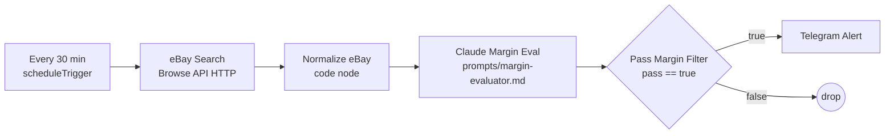
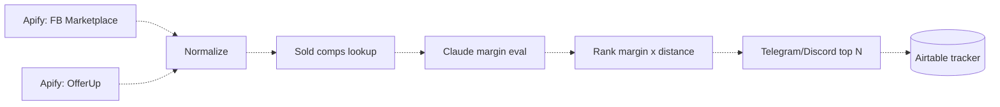

# Whatnot Sourcing Agent

n8n + Claude sourcing agent for Whatnot sellers: scans resale listings, estimates margin after Whatnot fees, and alerts on high-profit deals (sports cards, TCG, graded, sealed).

> **Status: early skeleton.** The committed n8n workflow covers one path — eBay search → normalize → Claude margin eval → margin filter → Telegram alert. Facebook Marketplace / OfferUp (Apify), sold-comp lookup, ranking, and the Airtable tracker are **designed in [`docs/pipeline.md`](docs/pipeline.md) but not built**. No production metrics are claimed.

## Status

| Stage | Design | Committed in `n8n/sourcing-workflow.json` | Status |
|---|---|---|---|
| 1. Trigger | Cron every 30 min + webhooks + `/scan` command | `Every 30 min` schedule trigger only | 🟡 Partial |
| 2a. Scrape — eBay | eBay Browse API | `eBay Search` HTTP node (hard-coded query `sports cards graded`, price ≤ $150, limit 50) | 🟡 Partial — needs OAuth creds |
| 2b. Scrape — FB Marketplace / OfferUp / liquidation | Apify actors / custom scrapers | — (only `APIFY_TOKEN` placeholder in `config/example.env`) | ⚪ Planned |
| 2c. Normalize | Common listing shape | `Normalize eBay` code node (title, price, currency, url, postal code, image) | 🟡 Partial — see known gaps |
| 3a. Sold comps lookup | eBay sold listings, other sources | — | ⚪ Planned |
| 3b. Margin evaluation | Claude + [`prompts/margin-evaluator.md`](prompts/margin-evaluator.md) | `Claude Margin Eval` node (prompt must be attached manually) | 🟡 Partial |
| 3c. Margin filter | `pass == true` (≥ 40% default) | `Pass Margin Filter` IF node | ✅ Wired |
| 4a. Rank (margin × distance) | `score = margin × 1/(1+miles)`, top N | — | ⚪ Planned |
| 4b. Alert | Telegram (+ Discord, email digest, Save/Skip/Bought buttons) | `Telegram Alert` text message only | 🟡 Partial |
| 5. Inventory tracker | Airtable / Notion / Sheets | — | ⚪ Planned |

## Architecture (what the committed workflow actually runs)



Planned extensions (not in the workflow JSON):



### Known gaps in the skeleton (honest list)

- **eBay results aren't split.** The Browse API returns one response with an `itemSummaries` array; `Normalize eBay` reads `item.json.title` directly, so an *Item Lists / Split Out* step on `itemSummaries` is needed first.
- **Claude node wiring.** `lmChatAnthropic` is a LangChain chat-model sub-node; in current n8n it must hang off a *Basic LLM Chain* / *AI Agent* node (or be swapped for an HTTP call to the Anthropic Messages API). The system prompt is not embedded — attach `prompts/margin-evaluator.md`.
- **No JSON parsing** of Claude's response before the IF node; add a structured output parser or a code node that `JSON.parse`s the reply so `$json.pass`, `net_profit`, `margin_pct` exist.
- **No comps are fed to Claude** yet, so estimates rely on the model's prior knowledge — not acceptable for real buying decisions.
- Model ID `claude-3-5-sonnet-20241022` is pinned; update to a current Claude model.
- Treat the workflow as a reference skeleton, not an import-and-run bot.

## System design notes

- **Orchestration in n8n, judgment in the LLM.** Scraping, filtering, and alerts are deterministic nodes; Claude only does comp matching and the margin estimate, returning strict JSON.
- **Fee math should be deterministic.** The prompt asks Claude to compute fees, but arithmetic is better done in a code node from `estimated_sell_price` — the LLM should estimate the sell price and comps, not do the subtraction. (Planned refactor.)
- **Conservative by default.** The prompt prefers skipping borderline deals; the 40% threshold (`MIN_MARGIN_PCT`) trades recall for fewer bad buys.
- **Human in the loop.** The agent never buys. It alerts; the seller verifies the listing, negotiates, pays, and picks up. Live streams stay human.
- **Cost control.** Pre-filter by price cap and category before any LLM call; only survivors hit Claude.

## Worked margin example

Using the formula from [`docs/whatnot-fees.md`](docs/whatnot-fees.md) (8% commission on item price; 2.9% + $0.30 processing on item + shipping). Fee figures are approximate — verify on your Whatnot seller dashboard.

**Deal A — buy a PSA 9 card for $40, conservative Whatnot sell price $80, buyer pays $5 shipping, you spend $5 on label/supplies:**

| Line | Math | Amount |
|---|---|---|
| Commission | 8% × $80 | $6.40 |
| Processing | 2.9% × ($80 + $5) + $0.30 | $2.77 |
| **Total Whatnot fees** | | **$9.17** (11.5% of sale) |
| Net after fees + your shipping | $80 − $9.17 − $5.00 | $65.83 |
| **Net profit** | $65.83 − $40 cost | **$25.83** |
| **Margin** (net profit ÷ cost) | $25.83 ÷ $40 | **64.6% → pass** |

**Deal B — same card listed at $60:** net profit $65.83 − $60 = $5.83 → 9.7% → **skip** (below 40%).

> Note: the prompt doesn't define `margin_pct`; this README and `docs/whatnot-fees.md` use net profit ÷ purchase cost.

## Sample margin evaluator I/O

Full illustrative file: [`docs/sample-margin-io.json`](docs/sample-margin-io.json) (hand-computed, not a recorded model run).

```json
{
  "pass": true,
  "estimated_sell_price": 80.00,
  "estimated_fees": 9.17,
  "estimated_shipping_cost": 5.00,
  "net_profit": 25.83,
  "margin_pct": 64.6,
  "reason": "Conservative sell price below comp average; clears 40% threshold after fees and shipping.",
  "comps_used": ["PSA 9 sold $84", "PSA 9 sold $79", "PSA 9 sold $82"]
}
```

## Test cases (manual — no automated tests yet)

| # | Input | Expected |
|---|---|---|
| 1 | $40 ask, comps ~$80 (Deal A) | `pass: true`, net ≈ $25.83, margin ≈ 64.6% |
| 2 | $60 ask, comps ~$80 (Deal B) | `pass: false`, margin ≈ 9.7% |
| 3 | Raw card listed, comps are PSA 10 only | `pass: false` — reason cites grade mismatch, no inflated estimate |
| 4 | Listing with no matching comps | `pass: false`, empty/low-confidence `comps_used` |
| 5 | eBay response with 0 `itemSummaries` | Workflow ends with no Telegram message, no error |

## Deploy & ops

1. Run n8n (self-hosted Docker or n8n Cloud).
2. **Workflows → Import from File** → `n8n/sourcing-workflow.json`.
3. Create credentials: eBay OAuth2 (Browse API), Anthropic, Telegram bot.
4. Fix the known gaps above (split `itemSummaries`, wrap the Claude node in an LLM chain with the system prompt, parse JSON).
5. Set env vars (`config/example.env`); the workflow currently reads only `TELEGRAM_CHAT_ID` directly — price cap and query are hard-coded in the eBay node.
6. Activate the workflow; watch executions for the first few runs.

| Variable | Used by committed workflow? |
|---|---|
| `EBAY_APP_ID`, `EBAY_CERT_ID`, `EBAY_DEV_ID`, `EBAY_TOKEN` | Via n8n eBay OAuth credential |
| `ANTHROPIC_API_KEY` | Via n8n Anthropic credential |
| `TELEGRAM_BOT_TOKEN` / `TELEGRAM_CHAT_ID` | Credential / `$env.TELEGRAM_CHAT_ID` |
| `APIFY_TOKEN` | Planned (FB/OfferUp) |
| `AIRTABLE_API_KEY`, `AIRTABLE_BASE_ID`, `AIRTABLE_TABLE_NAME` | Planned (tracker) |
| `MAX_ASKING_PRICE`, `MIN_MARGIN_PCT`, `SCAN_INTERVAL_MINUTES`, `TARGET_CATEGORIES` | Planned (currently hard-coded) |

### Estimated monthly cost (full design, unverified estimates)

| Service | Approx cost | In skeleton? |
|---|---|---|
| eBay Browse API | Free tier | Yes |
| Claude API | $10–30 (volume-dependent) | Yes |
| n8n | Free self-hosted / ~$24 Cloud | Yes |
| Telegram | Free | Yes |
| Apify (FB/OfferUp) | $5–20 | Planned |
| Airtable | Free tier | Planned |
| **Total** | **~$10–75** depending on hosting and sources | |

## What it does NOT do

- Buy anything, message sellers, or pick up items — you do that.
- Host or run Whatnot live streams.
- Guarantee prices: fee rates and comps are estimates.

## Project structure

```
whatnot-sourcing-agent/
├── README.md
├── config/example.env           # Env vars (some for planned stages)
├── docs/
│   ├── pipeline.md              # Full target design, stage by stage
│   ├── whatnot-fees.md          # Fee notes (approximate, late 2026)
│   └── sample-margin-io.json    # Illustrative evaluator input/output
├── n8n/sourcing-workflow.json   # Skeleton workflow (eBay → Claude → Telegram)
└── prompts/margin-evaluator.md  # Claude system prompt
```

## Roadmap

- [ ] Fix skeleton gaps (split, LLM chain, JSON parse) so import-and-run works
- [ ] eBay sold-comps lookup fed into the prompt
- [ ] Deterministic fee/margin code node
- [ ] Apify FB Marketplace + OfferUp sources
- [ ] Ranking + top-N alerts with Save/Skip/Bought buttons
- [ ] Airtable inventory tracker
- [ ] Fixture-based eval of the margin evaluator

## License

MIT — see [`LICENSE`](LICENSE).
